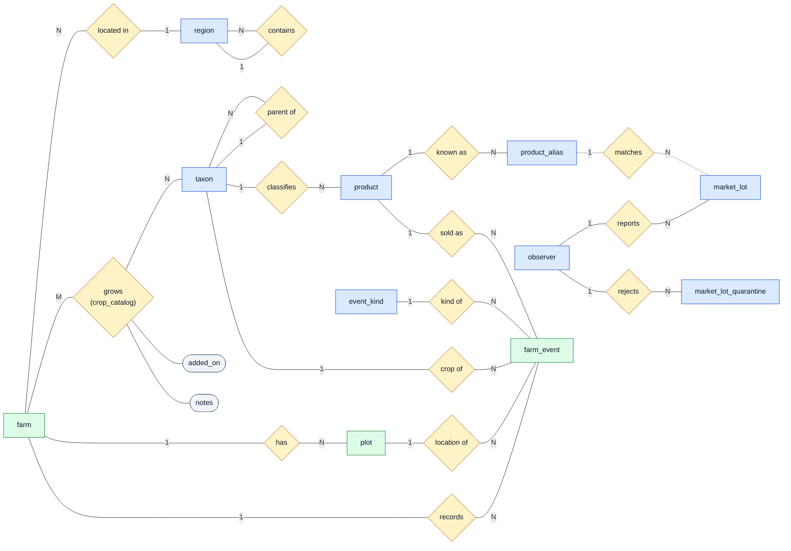

# Entity Relationship Diagram

The Almanac database as defined in [`db/schema.sql`](db/schema.sql): 12 tables and 15 foreign keys.

### How to Read It

| Shape | Meaning |
| --- | --- |
| Rectangle | Entity (a table). Blue is reference data we load; green is grower data users insert, update and delete. |
| Diamond | Relationship. The `1`, `N` and `M` on the lines give the cardinality: one region has N farms. |
| Oval | Attribute stored on a relationship. |
| Dotted line | A join on `label_norm`, not a foreign key. Lots are loaded before their labels are matched, so a lot can have no alias yet; it stays out of `v_priced_lot` until a match is confirmed. |

`crop_catalog` is drawn as the **grows** diamond because it is a many-to-many relationship between `farm` and `taxon`: its primary key is `(farm_id, taxon_id)` and it adds two attributes, `added_on` and `notes`. `region` and `taxon` each relate to themselves, which is how the county/state and plant family trees are stored.

## Tables

PK is the primary key, FK a foreign key, UK a unique column.

**observer** (auction source)

| Column | Type | Key | Rule |
| --- | --- | --- | --- |
| observer_id | integer | PK | generated |
| name | varchar(120) | UK | required |
| domain | varchar(255) | UK | |
| granularity | varchar(16) | | `lot` or `product_day` |

**region**

| Column | Type | Key | Rule |
| --- | --- | --- | --- |
| region_id | integer | PK | generated |
| parent_region_id | integer | FK to region | not its own parent |
| name | varchar(120) | | unique within parent |
| kind | varchar(20) | | `country`, `state`, `county` or `other` |

**taxon**

| Column | Type | Key | Rule |
| --- | --- | --- | --- |
| taxon_id | integer | PK | generated |
| parent_taxon_id | integer | FK to taxon | not its own parent |
| path | varchar(512) | UK | required |
| depth | smallint | | 0 to 11 |
| rank | varchar(20) | | required |
| scientific_name | varchar(200) | | required |
| common_name | varchar(200) | | |

**product**

| Column | Type | Key | Rule |
| --- | --- | --- | --- |
| product_id | integer | PK | generated |
| slug | varchar(80) | UK | lowercase |
| title | varchar(200) | | required |
| taxon_id | integer | FK to taxon | |

**product_alias**

| Column | Type | Key | Rule |
| --- | --- | --- | --- |
| label_norm | varchar(255) | PK | |
| product_id | integer | FK to product | deleted with its product |
| match_rung | smallint | | 0 to 4 |
| confirmed_at | timestamp | | required |

**market_lot**

| Column | Type | Key | Rule |
| --- | --- | --- | --- |
| lot_id | integer | PK | generated |
| observer_id | integer | FK to observer | required |
| sale_date | date | | 2019 or later |
| raw_label | varchar(255) | | required |
| label_norm | varchar(255) | | matched to product_alias |
| unit | varchar(40) | | |
| quantity | numeric(10,2) | | greater than 0 |
| low_cents, high_cents, avg_cents | integer | | 0 or more; low <= avg <= high |

**market_lot_quarantine** (lots that failed a check, with the reason)

| Column | Type | Key | Rule |
| --- | --- | --- | --- |
| quarantine_id | integer | PK | generated |
| observer_id | integer | FK to observer | required |
| sale_date, raw_label, unit, quantity, low/high/avg_cents | | | as in market_lot, unchecked |
| reason | varchar(255) | | required |
| quarantined_at | timestamp | | defaults to now |

**event_kind**

| Column | Type | Key | Rule |
| --- | --- | --- | --- |
| event_kind_code | varchar(20) | PK | plant, harvest, sale, loss |
| label | varchar(60) | UK | required |
| is_yield | boolean | | defaults to false |

**farm**

| Column | Type | Key | Rule |
| --- | --- | --- | --- |
| farm_id | integer | PK | generated |
| name | varchar(200) | | required |
| domain | varchar(255) | UK | |
| region_id | integer | FK to region | required |
| owner_email | varchar(255) | UK | |
| created_at | timestamp | | defaults to now |

**plot**

| Column | Type | Key | Rule |
| --- | --- | --- | --- |
| plot_id | integer | PK | generated |
| farm_id | integer | FK to farm | deleted with its farm |
| name | varchar(100) | | unique within farm |
| area_sq_m | numeric(10,2) | | greater than 0 |

**crop_catalog**

| Column | Type | Key | Rule |
| --- | --- | --- | --- |
| farm_id | integer | PK, FK to farm | deleted with its farm |
| taxon_id | integer | PK, FK to taxon | |
| added_on | date | | defaults to today |
| notes | varchar(500) | | |

**farm_event**

| Column | Type | Key | Rule |
| --- | --- | --- | --- |
| event_id | integer | PK | generated |
| farm_id | integer | FK to farm | deleted with its farm |
| plot_id | integer | FK to plot | optional; cleared if the plot is deleted |
| taxon_id | integer | FK to taxon | required |
| event_kind_code | varchar(20) | FK to event_kind | required |
| product_id | integer | FK to product | optional |
| event_date | date | | required |
| quantity | numeric(10,2) | | 0 or more |
| unit | varchar(40) | | required when quantity is set |
| notes | varchar(1000) | | |

## What Prevents Duplicates

| Table | Unique key | Stops |
| --- | --- | --- |
| `observer` | `name`, `domain` | The same auction source loaded twice |
| `region` | `(parent_region_id, name)` | Two counties with the same name in one state |
| `taxon` | `path` | The same plant twice in the taxonomy |
| `product` | `slug` | Two products with the same name |
| `product_alias` | `label_norm` (primary key) | One auction label pointing to two products |
| `event_kind` | `label` | Two event kinds with the same name |
| `farm` | `domain` (`farm_domain_unique`), `owner_email` (`farm_owner_email_unique`) | Two farms with the same website or owner |
| `plot` | `(farm_id, name)` (`plot_name_unique`) | Two plots with the same name on one farm |
| `crop_catalog` | `(farm_id, taxon_id)` (primary key) | The same crop listed twice for one farm |

Every numeric ID (`farm_id`, `plot_id`, `event_id` and the rest) is `GENERATED ALWAYS AS IDENTITY`, so the database assigns it and users cannot supply or reuse one.

## Views

| View | Joins | Purpose |
| --- | --- | --- |
| `v_priced_lot` | `market_lot`, `observer`, `product_alias`, `product` | Matched auction lots with prices in dollars |
| `v_resolution_coverage` | `market_lot`, `observer`, left join `product_alias` | Share of lots matched to a product, per source |
