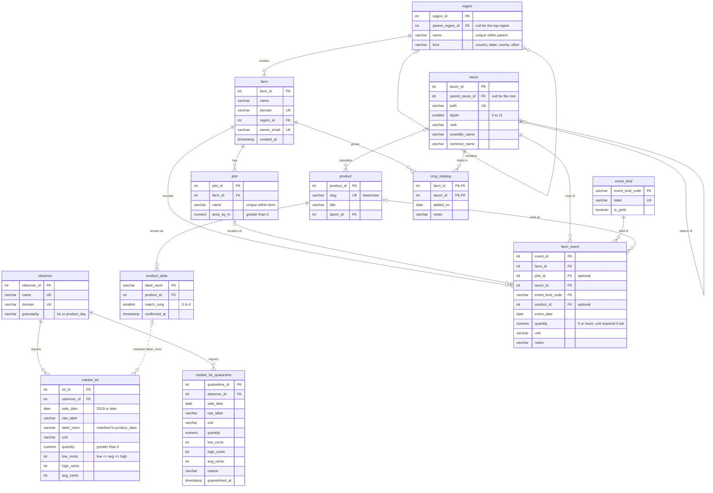

# Entity Relationship Diagram

The Almanac database as defined in [`db/schema.sql`](db/schema.sql): 12 tables and 15 foreign keys.

Solid lines are foreign keys. The dotted line from `product_alias` to `market_lot` is a join on `label_norm`, not a foreign key: lots are loaded before their labels are matched, so a lot can have no alias yet. Those lots stay out of `v_priced_lot` until a match is confirmed.

## What Prevents Duplicates

| Table | Unique key | Stops |
| --- | --- | --- |
| `observer` | `name`, `domain` | The same auction source loaded twice |
| `region` | `(parent_region_id, name)` | Two counties with the same name in one state |
| `taxon` | `path` | The same plant twice in the taxonomy |
| `product` | `slug` | Two products with the same name |
| `product_alias` | `label_norm` (primary key) | One auction label pointing to two products |
| `event_kind` | `label` | Two event kinds with the same name |
| `farm` | `domain` (`farm_domain_unique`), `owner_email` (`farm_owner_email_unique`) | Two farms with the same website or owner |
| `plot` | `(farm_id, name)` (`plot_name_unique`) | Two plots with the same name on one farm |
| `crop_catalog` | `(farm_id, taxon_id)` (primary key) | The same crop listed twice for one farm |

Every numeric ID (`farm_id`, `plot_id`, `event_id` and the rest) is `GENERATED ALWAYS AS IDENTITY`, so the database assigns it and users cannot supply or reuse one.

## Views

| View | Joins | Purpose |
| --- | --- | --- |
| `v_priced_lot` | `market_lot`, `observer`, `product_alias`, `product` | Matched auction lots with prices in dollars |
| `v_resolution_coverage` | `market_lot`, `observer`, left join `product_alias` | Share of lots matched to a product, per source |
